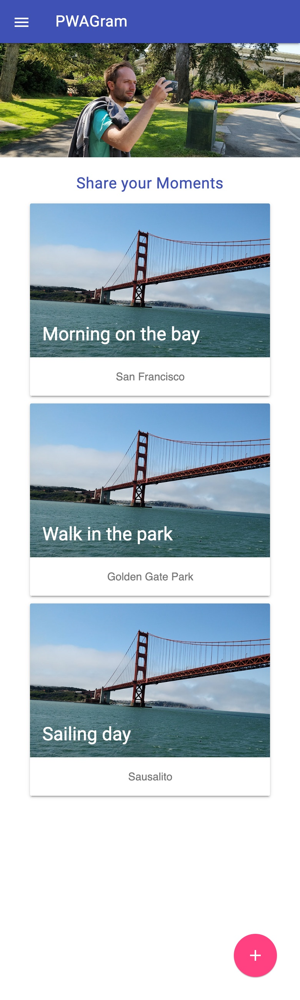

# PWA Simple IG

A simple Instagram-like Progressive Web App. Take a photo with the camera, add a title and location, and share it to a feed that keeps working offline.

> **Note:** uploading the photo itself to storage is not implemented yet. New posts are saved with their title and location and shown with a sample image.



## Features

- **Installable** with a web app manifest and app icons
- **Offline support** with a service worker:
  - App shell precached on install, with an offline fallback page
  - Feed loaded with a *cache, then network* strategy
  - Posts cached in IndexedDB so the feed shows without a connection
- **Camera capture** with `getUserMedia`, falling back to a file picker
- **Background sync**: posts created offline are queued in IndexedDB and sent when the connection is back
- **Push notifications** with the Push API and VAPID keys: subscribers get a notification for every new post

## Project structure

```
client/                  # Static PWA (served with http-server)
└── public/
    ├── index.html, help/, offline.html
    ├── manifest.json
    ├── sw.js            # Service worker: caching, background sync, push
    └── src/js/
        ├── config.js    # Firebase URL, VAPID public key, API URL
        ├── app.js       # SW registration, install prompt, push subscription
        ├── feed.js      # Feed, camera capture, create post
        └── utility.js   # IndexedDB helpers
server/                  # Express + TypeScript API
└── src/index.ts         # Stores posts in Firebase and sends push notifications
```

## Getting started

Requirements: Node.js and Yarn, plus a Firebase project with a **Realtime Database**.

### 1. Generate VAPID keys

```bash
cd server
yarn install
yarn web-push generate-vapid-keys
```

### 2. Configure the client

Edit `client/public/src/js/config.js`:

| Setting | Value |
| ------- | ----- |
| `FIREBASE_DB_URL` | Your Realtime Database URL, e.g. `https://<project-id>-default-rtdb.<region>.firebasedatabase.app` |
| `VAPID_PUBLIC_KEY` | The public key from step 1 |
| `API_URL` | The server URL (default `http://localhost:4000`) |

### 3. Start the server

```bash
cd server
FIREBASE_DB_URL=https://<your-database-url> \
VAPID_PUBLIC_KEY=<public-key> \
VAPID_PRIVATE_KEY=<private-key> \
yarn start
```

Optional: `VAPID_SUBJECT` (default `mailto:test@example.com`) and `PORT` (default `4000`). Keep the private key out of the repository.

### 4. Start the client

```bash
cd client
yarn install
yarn start
```

Open the URL that `http-server` prints (http://localhost:8080 by default).

The app reads and writes the `posts` and `subscription` nodes without authentication, so set your database rules accordingly for local testing only.

## Tips

- Service workers only run on `localhost` or HTTPS.
- After changing cached files, bump `CACHE_STATIC_NAME` in `sw.js` so browsers pick up the new version.
- To reset, unregister the service worker and clear site data in the browser's DevTools (Application tab).
